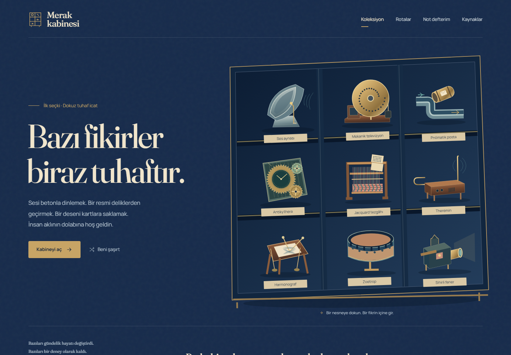
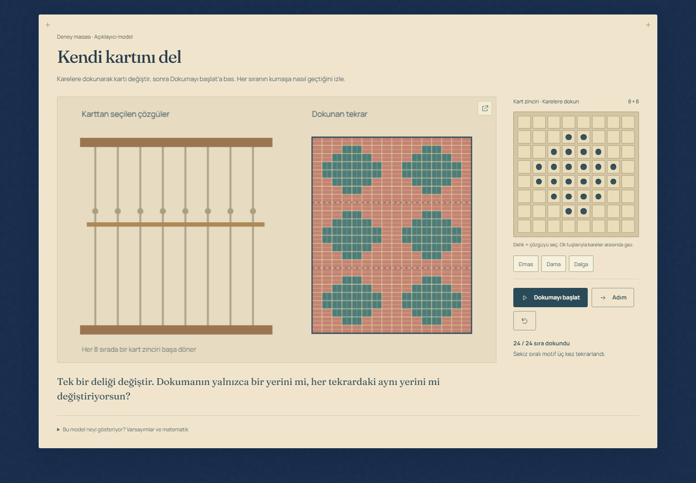
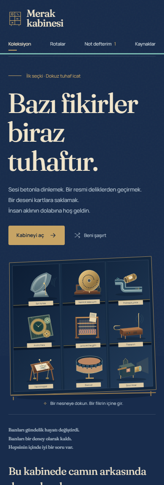

# Merak Kabinesi

An interactive Turkish-language cabinet of historical technological curiosities. Nine unusual objects connect material history with mechanisms you can operate in the browser.

**[Explore the collection](https://kulieff21.github.io/merak-kabinesi/)** · [Source book](https://kulieff21.github.io/merak-kabinesi/#/kaynaklar)



## Inside the cabinet

| Object | What you can do |
| --- | --- |
| Acoustic mirror | Change incidence angle and observe geometric focusing |
| Mechanical television | Reconstruct the same image at 12, 24 or 48 scan lines |
| Pneumatic mail | Send a capsule; compare pressure, load and a friction threshold |
| Antikythera mechanism | Turn two conceptual calendar dials through a 19-year cycle |
| Jacquard loom | Edit an 8×8 punched-card pattern and weave its repetitions |
| Theremin | Play an opt-in tone with two continuous controls |
| Harmonograph | Change frequency ratio, phase and damping; export the drawing as SVG |
| Zoetrope | Compare discrete frames, rotation speed and an open/closed shutter illustration |
| Magic lantern | Move the slide and screen; find the thin-lens image plane |

Each object has a dedicated link, an original illustration, three short interpretive sections, a timeline, cited sources and a disclosure of the educational model's assumptions. The collection has 21 distinct source records, three curated routes, Turkish-aware search, a local visit/saved-object notebook, JSON export, diagram enlargement, and print styles.



## Evidence and limits

Historical statements are separated from selected numerical examples and conceptual reconstructions. Source notes disclose institutional access failures, catalogue migration, indexed-only passages and abstract-only access. These are working educational models, not claims of complete archaeological or engineering reconstruction.

- [Research decisions and model boundaries](docs/RESEARCH.md)
- [Validation results](docs/VALIDATION.md)
- [Architecture and maintenance](docs/ARCHITECTURE.md)
- [Font licenses and asset provenance](THIRD_PARTY.md)

## Development

Requires Node.js 22 or newer. No dependency installation is required.

```sh
npm run dev
npm test
npm run build
```

Open the URL printed by the development server, normally `http://127.0.0.1:4178/`. `dist/` is a standalone static deployment. Opening the HTML through `file://` is not supported because the application uses ES modules.

For installed Chrome/Chromium browser checks, keep the preview running and use:

```sh
node scripts/browser-qa.mjs
```

No runtime framework, API keys, dependency installation or third-party network calls are needed. The only application storage is the visitor's notebook in that browser. Audio is off until explicitly enabled and closes when its exhibit is left.



## Ownership

Created for and maintained by [Elmar Quliyev](https://github.com/kulieff21). All repository commits use the owner's configured GitHub identity. No collaborators are required.

Historical sources are linked individually. Museum photographs are not bundled; illustrations and diagrams are original. Bundled fonts retain their SIL Open Font Licenses. No project-wide reuse license is implied by the repository's public visibility.
